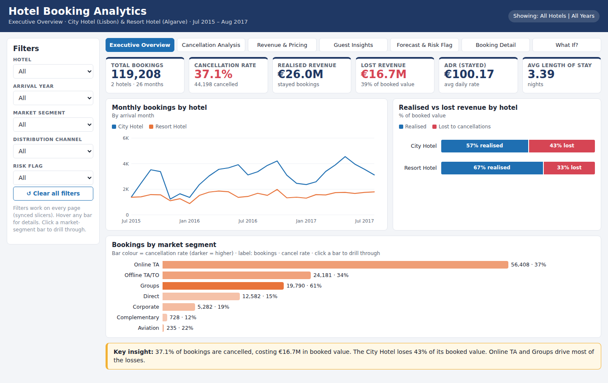
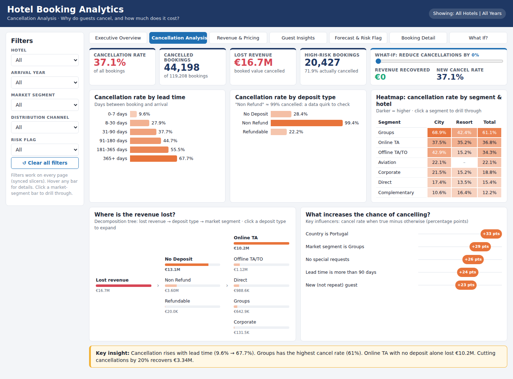
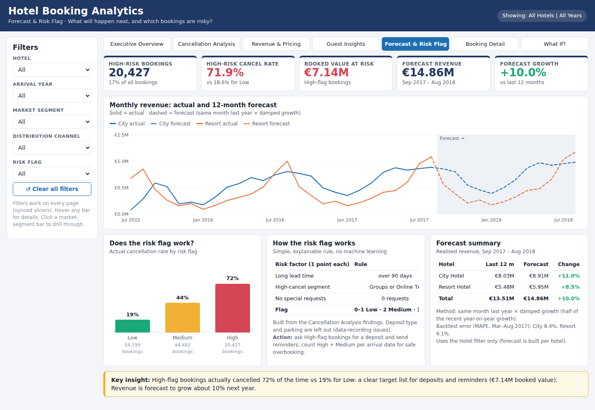
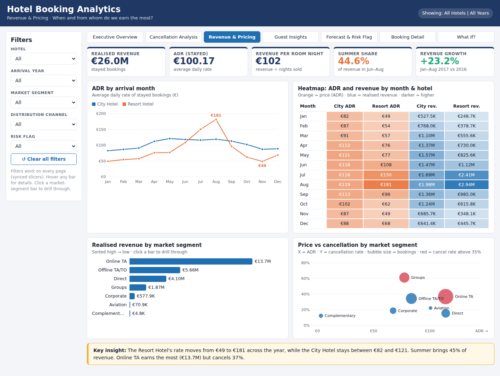
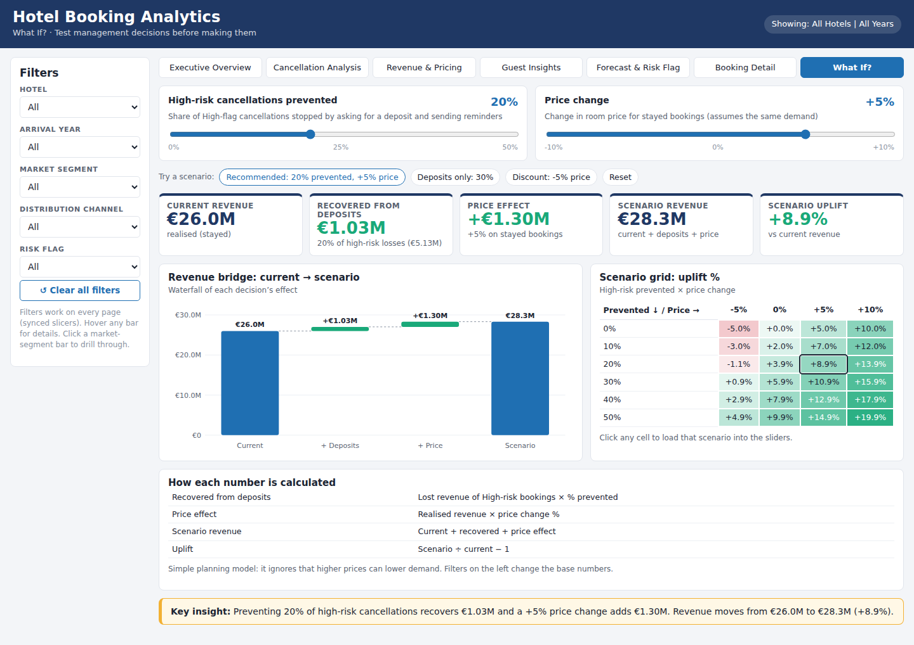

# Hotel Booking Analytics – Reducing Cancellation Losses

**Business Analytics capstone project** · Python · Excel · Power BI

More than **1 in 3 hotel bookings is cancelled**. This project analyses **119,208 bookings** from two hotels in Portugal (a City Hotel in Lisbon and a Resort Hotel in the Algarve, July 2015 – August 2017). It finds why guests cancel, flags risky bookings with a simple rule, forecasts the next 12 months, and turns the findings into recommendations with a money value.

👉 **[Open the interactive dashboard](dashboards/hotel_dashboard.html)**. Download the file and open it in any browser, or use the GitHub Pages link if it is switched on.



---

## Key results

| | |
|---|---|
| Bookings analysed | **119,208** (after removing 182 invalid rows) |
| Cancellation rate | **37.1%** (City Hotel 41.8%, Resort Hotel 27.8%) |
| Revenue earned / lost to cancellations | **€26.0M / €16.7M** |
| Strongest driver | Lead time: **9.6%** cancel (booked within 7 days) → **67.7%** (booked 1 year+ ahead) |
| Rule-based risk flag | High-flag bookings cancelled **72%** vs **19%** for Low |
| 12-month forecast | **€14.86M, +10%** (backtest error 6–8% MAPE, half of a "same as last year" forecast) |
| What-if scenario | Deposits on 20% of high-risk bookings + 5% price rise → **€28.3M (+9%)** |

## Business problem and objectives

Management had no single view of **why** guests cancel, **which** bookings are at risk, or **how much** demand to expect. The project answers five research objectives:

1. Overall performance and seasonality
2. Drivers of cancellation and the revenue lost
3. Market segment and channel comparison
4. Guest profile and loyalty
5. 12-month revenue and booking forecast

The method follows **CRISP-DM**: business understanding → data understanding → data preparation → modelling (risk flag and forecast) → evaluation (backtest) → deployment (dashboards).

## What is in this repository

```
├── notebooks/        Python analysis, already run, so outputs are visible
│   ├── 01_Clean.ipynb      cleaning, checks, feature engineering, star schema
│   ├── 02_Analyse.ipynb    KPIs, driver analysis, risk flag, forecast + backtest
│   └── 03_Charts.ipynb     report charts (matplotlib)
├── dashboards/
│   ├── hotel_dashboard.html          7-page interactive dashboard (runs in any browser)
│   ├── Hotel_Booking_Analytics.xlsx  Excel dashboard (COUNTIFS/SUMIFS, drop-down filters)
│   └── powerbi_theme.json            Power BI colour theme
├── reports/
│   ├── Capstone_Report.pdf           full written report
│   └── Capstone_Presentation.pdf     presentation slides
├── images/           dashboard screenshots and report charts
└── data/
    ├── raw/                          original booking data (5 CSV files)
    └── cleaning_log.csv              every cleaning step and rows affected
```

## Dashboard pages

| Page | Question it answers |
|---|---|
| 1. Executive Overview | How are the hotels performing? |
| 2. Cancellation Analysis | Why do guests cancel, and what does it cost? |
| 3. Revenue & Pricing | When and from whom do we earn the most? |
| 4. Guest Insights | Who are the guests and what do they want? |
| 5. Forecast & Risk Flag | What happens next, and which bookings are risky? |
| 6. Booking Detail | Drill-through into one market segment |
| 7. What If? | Test deposit and pricing decisions before making them |

<table>
<tr><td></td><td></td></tr>
<tr><td></td><td></td></tr>
</table>

## Approach

**1. Data cleaning (Python).**
- Checked that all IDs match the lookup tables.
- Filled blanks: children → 0, unknown country, no agent or company.
- Removed 182 invalid rows (0 guests, a negative price, and one €5,400 typo).
- Kept 32,995 look-alike rows, because they are most likely group rooms.
- Added 17 new columns, such as booking value, realised and lost revenue, lead-time band and season.

**2. Analysis.** Compared the cancellation rate and revenue by lead time, market segment, deposit type, special requests, country, season and repeat guests.

**3. Rule-based risk flag (no machine learning).** Each booking gets 1 point for each of these:
- lead time over 90 days
- Groups or Online travel agent booking
- no special requests

3 points = **High**, 2 = Medium, 0–1 = Low. The rule is simple, so managers can understand, check and change it.

**4. Forecast.**
- **Method:** each month = same month last year × (1 + half of the recent growth).
- **Backtest:** tested on March–August 2017 with MAPE (average % error).

**5. Dashboards.** The same clean data feeds:
- an **Excel** workbook with drop-down filters and live formulas
- a **Power BI** report with a star schema, DAX measures, drill-through, what-if parameters and bookmarks
- an **HTML** version that runs in any browser

## Recommendations

1. Ask **High-flag bookings for a deposit**: preventing 20% of their cancellations recovers about **€1.0M**.
2. Count High and Medium flags per arrival date for **safer overbooking**.
3. **Grow direct bookings**: they have a similar price to online agents, cancel 15% vs 37%, and pay no commission.
4. **Tighten group and online-agent terms** with staged deposits and room-block release dates.
5. **Engage long-lead guests**: guests who make a request cancel 22%, against 48% for those who make none.
6. **Price by season** and start a **loyalty programme**, since only 3.1% of guests are repeat guests.

## How to run the notebooks

```bash
pip install pandas numpy matplotlib pycountry jupyter
cd notebooks
jupyter notebook        # run 01_Clean → 02_Analyse → 03_Charts
```

## Tools

Python (pandas, NumPy, matplotlib) · Jupyter · Microsoft Excel · Power BI (DAX, Power Query) · HTML/JavaScript

## Data source

Hotel booking demand data from Antonio, N., de Almeida, A. & Nunes, L. (2019). *Hotel booking demand datasets*. **Data in Brief, 22**, 41–49. The data was provided as five related tables for this capstone.

## Author

**Junaidi Abdul Rahim (Arjun)** · Associate Data Analyst trainee, Singapore
